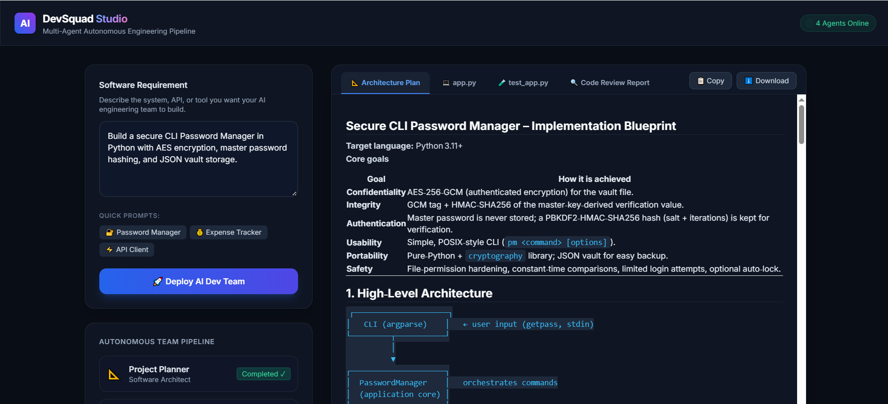
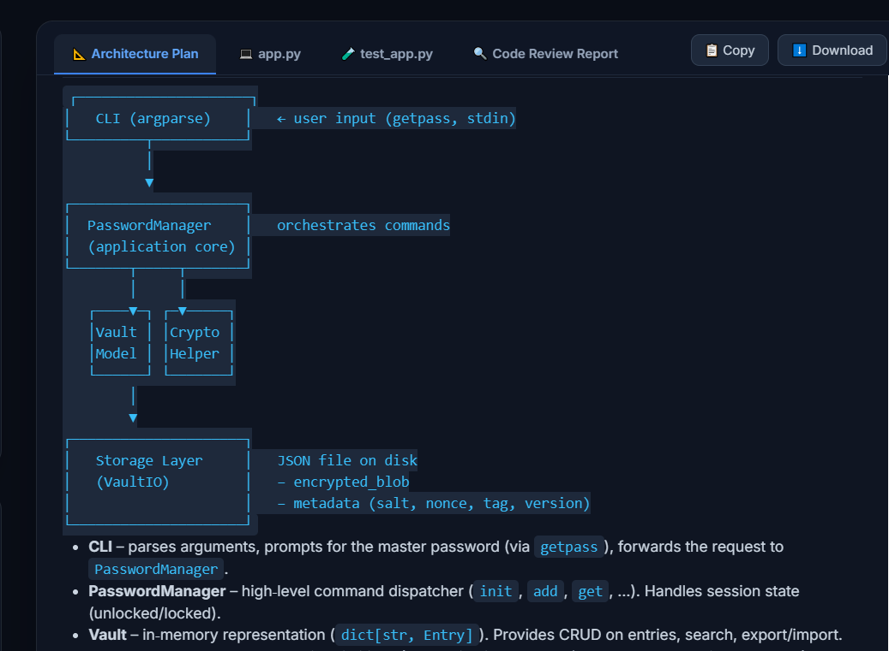
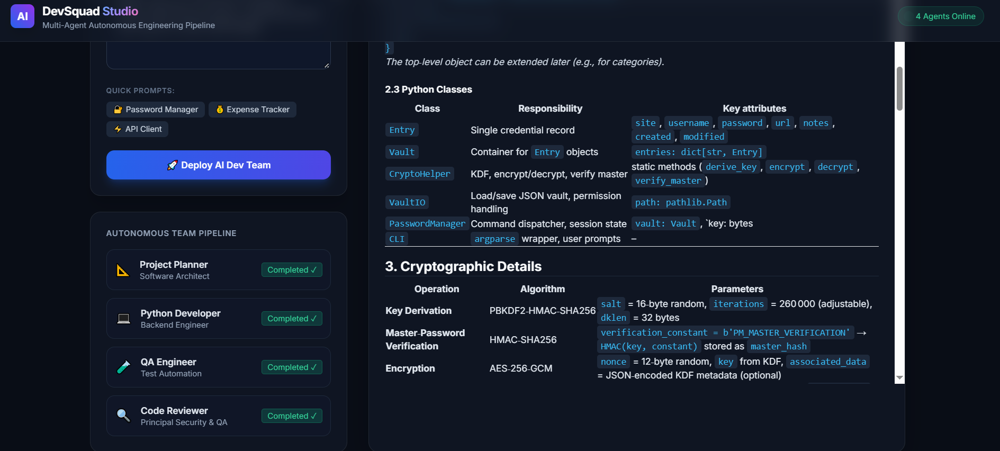
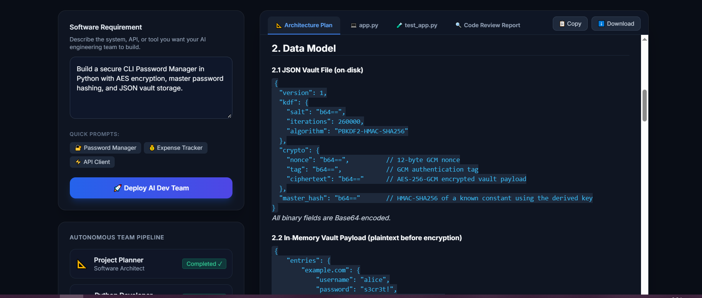
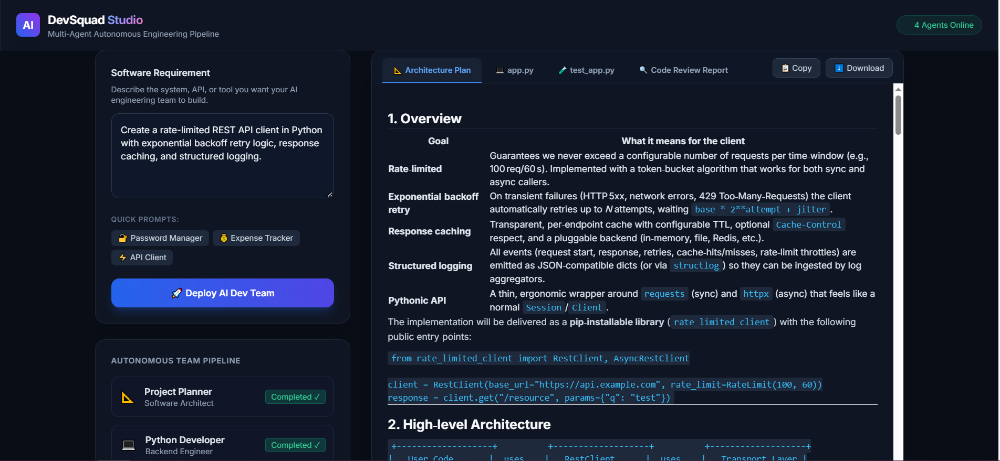

# 🚀 DevSquad Studio — Autonomous Multi-Agent Software Engineering Pipeline

[](https://www.python.org/)
[](https://fastapi.tiangolo.com/)
[](https://tailwindcss.com/)
[](https://console.groq.com/)

**DevSquad Studio** is an end-to-end **Autonomous Multi-Agent Software Development System** that simulates a 4-member agile engineering team. Given a natural-language software requirement, the system orchestrates specialized AI agents to architect the solution, write modular production-ready Python code, generate comprehensive unit tests, and perform a security & quality code review — complete with a sleek **SaaS Web Dashboard** and **CLI interface**.

---

## 📸 Product Showcase & Live Walkthrough

### 1. Studio Dashboard & Requirement Architecture Generation
The interactive web interface allows users to enter custom software requirements or trigger built-in presets, while monitoring all **4 AI Agents** in real time.


### 2. High-Level System Blueprint & Component Flow
The **Project Planner (Software Architect)** agent generates detailed ASCII architecture diagrams, module breakdowns, and data-flow specifications[cite: 3].


### 3. Autonomous Team Pipeline Completion & Class Specifications
Once executed, all four agents transition to `Completed ✓` status while producing class responsibilities, method signatures, and cryptographic/security specifications[cite: 4].


### 4. Structured Data Models & Schema Design
Generated blueprints include complete JSON storage schemas, payload structures, and technical specifications ready for backend implementation[cite: 5].


### 5. Multi-Domain Versatility (API Clients, CLI Tools & Backends)
The pipeline dynamically adapts to diverse engineering tasks—such as rate-limited REST API clients with exponential backoff, caching, and structured logging—with one-click **Copy** and **Download** exports[cite: 6].


---

## 🤖 Multi-Agent Architecture

The workflow automates the Software Development Life Cycle (SDLC) through four specialized, sequential agents:

| Agent | Role | Core Responsibility | Output Artifact |
| :--- | :--- | :--- | :--- |
| 📐 **Project Planner** | Software Architect | Analyzes requirements, defines classes/functions, data models, and system design[cite: 2, 3, 4, 5]. | `output/implementation_plan.md` |
| 💻 **Python Developer** | Backend Engineer | Writes clean, modular, production-ready Python code with docstrings and error handling[cite: 4]. | `output/app.py` |
| 🧪 **QA Engineer** | Test Automation | Builds comprehensive unit test suites (`unittest`/`pytest`) covering edge cases and invalid inputs[cite: 4]. | `output/test_app.py` |
| 🔍 **Code Reviewer** | Principal Reviewer | Audits implementation and test code for bugs, security flaws, and performance bottlenecks[cite: 4]. | `output/development_report.md` |

---

## ✨ Key Features

- **Autonomous 4-Agent Orchestration:** Seamless handoff of context from architectural planning to code generation, automated QA, and final review[cite: 4].
- **Modern SaaS Web UI:** Dark-mode glassmorphism dashboard built with **FastAPI**, **Tailwind CSS**, **Marked.js**, and **Highlight.js** for live Markdown rendering and Python syntax highlighting[cite: 2, 5].
- **One-Click Artifact Export:** Inspect generated files across tabs (`Architecture Plan`, `app.py`, `test_app.py`, `Code Review Report`), copy to clipboard, or download directly[cite: 2, 6].
- **Dual Execution Modes:** Run via the interactive Web Studio (`app_server.py`) or directly from the terminal (`main.py`).
- **Automatic Local Persistence:** Every run automatically saves all four deliverables inside the `output/` directory.

---

## 📂 Project Structure

```text
ai_dev_team/
│
├── agents/                     # Specialized AI Agent modules
│   ├── __init__.py
│   ├── planner.py              # Software Architect agent
│   ├── developer.py            # Backend Python Developer agent
│   ├── qa.py                   # QA & Unit Testing agent
│   └── reviewer.py             # Senior Code Reviewer agent
│
├── templates/
│   └── index.html              # Responsive SaaS Frontend (Tailwind + JS)
│
├── images/                     # Project screenshots for documentation
│   ├── Capture1.PNG
│   ├── Capture2.PNG
│   ├── Capture3.PNG
│   ├── Capture4.PNG
│   └── Capture5.PNG
│
├── output/                     # Auto-generated deliverables saved here
├── app_server.py               # FastAPI backend server
├── main.py                     # CLI orchestrator script
├── requirements.txt            # Python dependencies
└── README.md                   # Project documentation

🛠️ Setup & Installation

1. Clone the Repository

git clone [https://github.com/your-username/devsquad-studio.git](https://github.com/your-username/devsquad-studio.git)
cd squads-studio


2. Create & Activate Virtual Environment

Windows (PowerShell):

python -m venv venv
.\venv\Scripts\Activate.ps1

macOS / Linux:

python3 -m venv venv
source venv/bin/activate

3. Install Dependencies

pip install -r requirements.txt
pip install fastapi uvicorn jinja2

4. Configure Environment Variables

Create a .env file in the root directory and add your API key:

GROQ_API_KEY=your_api_key_here

🚀 Usage
Option A: Launch the Web Studio (Recommended)
Bash
uvicorn app_server:app --reload
Open your browser and navigate to http://127.0.0.1:8000, enter your requirement (or select a Quick Prompt), and click Deploy AI Dev Team[cite: 2].

Option B: Run via Command Line (CLI)
Bash
python main.py
🛡️ Security Best Practices
Ensure .env and venv/ are added to your .gitignore file before pushing to GitHub so your API keys remain secure.


---

### 💡 GitHub Par Push Karne Se Pehle Ek Choti Si Tip:
Apne project folder mein ek **`.gitignore`** file zaroor banayein aur usmein yeh 3 lines likh dein taake aapki private API key aur `venv` folder GitHub par upload na ho:
```text
.env
venv/
__pycache__/